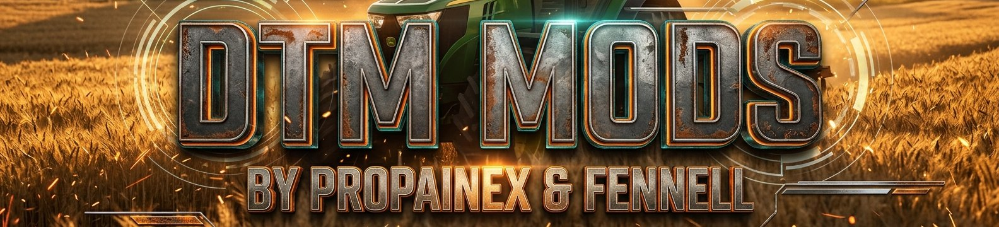

  

<h1 align="center">DTM-Mods/.github</h1>

  
  

The shared files of the [DTM Mods](https://github.com/DTM-Mods) organization. Nothing here is a mod: this
repository holds the organization's front page, the build that every mod repository uses, and the pictures the
READMEs and Discord posts link to.

Looking for the mods? They are on the [organization page](https://github.com/DTM-Mods) and on
[dtmmods.com](https://dtmmods.com).

## What is in here

| Folder or file | What it is |
|----------------|------------|
| [`profile/README.md`](profile/README.md) | The organization's front page: every mod with its icon and latest release |
| [`.github/workflows/fs25-mod.yml`](.github/workflows/fs25-mod.yml) | The shared build. Every mod's `build.yml` calls it: checks, zip, releases |
| [`.github/workflows/check.yml`](.github/workflows/check.yml) | Checks this repository itself on every push (see below) |
| [`.github/workflows/weekly-downloads.yml`](.github/workflows/weekly-downloads.yml) | Posts the release download counts to the staff channel every Monday |
| [`ci/`](ci/) | The build's scripts and the lists of where each mod is published. [`ci/README.md`](ci/README.md) explains all of it |
| [`workflow-templates/`](workflow-templates/) | The `build.yml` a new mod repository starts from (Actions > New workflow > "DTM FS25 mod") |
| [`assets/`](assets/) | Pictures: the README section banners, mod icons (`icons/`), README screenshots (`screens/`), the logo (`brand/`) |
| `.github/ISSUE_TEMPLATE/`, `.github/DISCUSSION_TEMPLATE/` | The bug report, translation and idea forms of every repository |
| `CONTRIBUTING.md`, `SUPPORT.md`, `SECURITY.md`, `CODE_OF_CONDUCT.md`, `.github/FUNDING.yml` | Apply to every repository that has none of its own |

## Changing something here reaches every mod

Every mod repository runs the build and its scripts from `main` of this repository, and the READMEs and Discord posts
load the pictures in `assets/` straight from `main`. A change is live for all of them the moment it is pushed.

So this repository checks itself ([`check.yml`](.github/workflows/check.yml)) on every push and once a week:

- the Python files compile and the workflows and forms are valid YAML
- the lists in `ci/` only name mods from the organization page, and every itch.io page in `itch.json` exists
- every mod on the organization page has a 256x256 icon in `assets/icons/`
- the pushed `ci/fs25_mod.py` checks and builds four real mods (a script mod, a placeable, a vehicle and a fork)

Run the first three before pushing with `python ci/check_repo.py`. When the check turns red, fix or revert before
the next mod is pushed.

## Adding a mod

1. Push its icon to `assets/icons/<repository>.png` (256x256) **before** its first version reaches `main`:
   Discord fetches the picture once, when the release post goes out.
2. Add its row to [`profile/README.md`](profile/README.md).
3. In the new repository: **Actions** > **New workflow** > **DTM FS25 mod**. The rest is in
   [`ci/README.md`](ci/README.md).
4. When it has a page on itch.io or KingMods, add it to [`ci/itch.json`](ci/itch.json) or
   [`ci/kingmods.json`](ci/kingmods.json); on GIANTS' ModHub, to [`ci/modhub.json`](ci/modhub.json).

## License

MIT, see [LICENSE](LICENSE). The DTM Mods name and logo are ours.

---

   
  Part of <a href="https://github.com/DTM-Mods">DTM Mods</a> (Designed To Manage) by PropaineX & Fennell  
  
   
  
  
  

