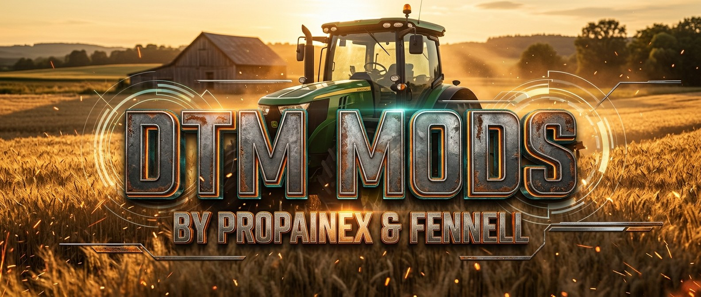

  

<h3 align="center">Farming Simulator 25 mods by PropaineX & Fennell</h3>

  Mod overviews • Custom assets • Gameplay enhancements

---

### Our mods

| Mod | Author |
| --- | --- |
| [Searchables](https://github.com/DTM-Mods/FS25_Searchables) | Fennell |
| [Logistics Hub](https://github.com/DTM-Mods/FS25_PalletDepot) | Fennell |
| [Deployables Anywhere](https://github.com/DTM-Mods/FS25_DeployablesAnywhere) | Fennell |
| [Roadside Stand](https://github.com/DTM-Mods/FS25_RoadsideStand) | Fennell |
| [Pig Barn With Feeding Robot](https://github.com/DTM-Mods/FS25_PigBarnWithRobot) | Fennell |
| Pallet Storage And Logistics | Fennell |
| [F1 Toggle](https://github.com/DTM-Mods/FS25_F1Toggle) | Fennell |
| [Recoup Money](https://github.com/DTM-Mods/FS25_RecoupMoney) | Fennell |
| [No AI Collisions Pro Edition](https://github.com/PropaineX/FS25_NoAICollisions_ProEdition) | PropaineX |
| [Parking Brake Pro Edition](https://github.com/PropaineX/FS25_ParkingBrake_ProEdition) | PropaineX |
| [Player Trading+ Pro Edition](https://github.com/PropaineX/FS25_PlayerTradingPlus) | PropaineX |
| [Box Truck Pro Edition](https://github.com/PropaineX/FS25_ProEdition_BoxTruck) (work in progress) | PropaineX |
| Server Lag Watch | PropaineX |
| My Silo Prices Tab | PropaineX |
| Ropa Tiger 6S Pro Edition | PropaineX |
| Magnon Stone Picker BD Pro Edition | PropaineX |
| FS22 Buildings | PropaineX |

### Forks we work on

| Mod | Original |
| --- | --- |
| [AutoDrive Overdrive](https://github.com/DTM-Mods/FS25_AutoDrive) | AutoDrive Team ([Stephan-S/FS25_AutoDrive](https://github.com/Stephan-S/FS25_AutoDrive)) |
| [Courseplay](https://github.com/DTM-Mods/FS25_Courseplay) | Courseplay devTeam ([Courseplay/Courseplay_FS25](https://github.com/Courseplay/Courseplay_FS25)) |
| [Better Contracts](https://github.com/DTM-Mods/FS25_BetterContracts) | [Mmtrx](https://github.com/Mmtrx/FS25_BetterContracts) |

### Bugs and requests

Open an issue in the mod's repository. Please attach your `log.txt` and say which mod version you're on.
