

  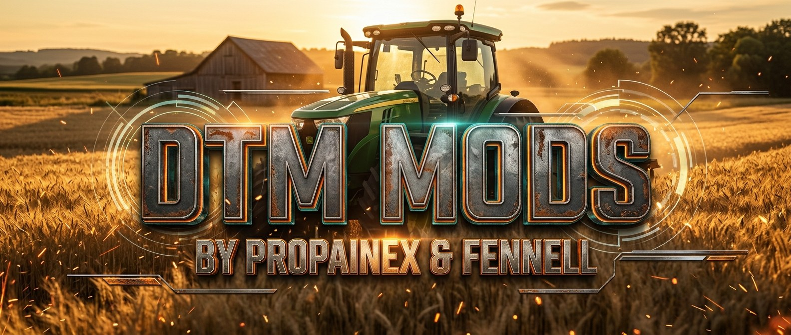

  
  
  
  

  
  
  

  <b>Farming Simulator 25 mods, built and tested on our own server.</b> 
  Quality-of-life scripts, Pro Edition machines and placeables, and the forks we keep running.

### Fennell

| | Mod | By | Latest | Downloads | Stars |
| :-: | --- | --- | --- | :-: | :-: |
|  | **[Searchables](https://github.com/DTM-Mods/FS25_Searchables)** | Fennell |  |  |  |
| 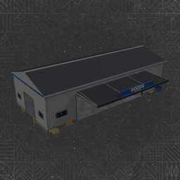 | **[Logistics Hub](https://github.com/DTM-Mods/FS25_PalletDepot)** | Fennell |  |  |  |
|  | **[Deployables Anywhere](https://github.com/DTM-Mods/FS25_DeployablesAnywhere)** | Fennell |  |  |  |
|  | **[Roadside Stand](https://github.com/DTM-Mods/FS25_RoadsideStand)** | Fennell |  |  |  |
| 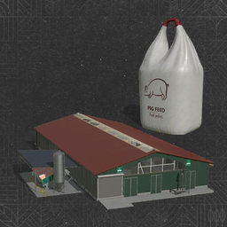 | **[Pig Barn With Feeding Robot](https://github.com/DTM-Mods/FS25_PigBarnWithRobot)** | Fennell |  |  |  |
| 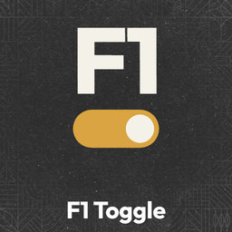 | **[F1 Toggle](https://github.com/DTM-Mods/FS25_F1Toggle)** | Fennell |  |  |  |
|  | **[Recoup Money](https://github.com/DTM-Mods/FS25_RecoupMoney)** | Fennell |  |  |  |
|  | **[Banana Regrow](https://github.com/DTM-Mods/FS25_BananaRegrow)** | Fennell |  |  |  |
|  | **[Mass Tree Exterminator](https://github.com/DTM-Mods/FS25_MassTreeExterminator)** | Fennell |  |  |  |
|  | **[Mod Reveal](https://github.com/DTM-Mods/FS25_ModReveal)** | Fennell |  |  |  |
| 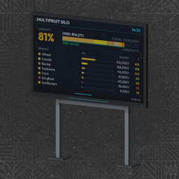 | **[Better Digital Display](https://github.com/DTM-Mods/FS25_DigitalDTM)** | Fennell |  |  |  |
|  | **[ModMux](https://github.com/DTM-Mods/FS25_ModMux)** | Fennell |  |  |  |
|  | **[Auto Admin](https://github.com/DTM-Mods/FS25_AutoAdmin)** | Fennell |  |  |  |

### PropaineX

| | Mod | By | Latest | Downloads | Stars |
| :-: | --- | --- | --- | :-: | :-: |
|  | **[No AI Collisions Pro Edition](https://github.com/DTM-Mods/FS25_NoAICollisions_ProEdition)** | PropaineX |  |  |  |
|  | **[Parking Brake Pro Edition](https://github.com/DTM-Mods/FS25_ParkingBrake_ProEdition)** | PropaineX |  |  |  |
|  | **[Player Trading+ Pro Edition](https://github.com/DTM-Mods/FS25_PlayerTradingPlus)** | PropaineX |  |  |  |
|  | **[Box Truck Pro Edition](https://github.com/DTM-Mods/FS25_ProEdition_BoxTruck)** | PropaineX |  |  |  |
| 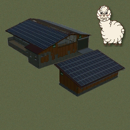 | **[Alpaca PRX500](https://github.com/DTM-Mods/FS25_AlpacaPRX500)** | PropaineX |  |  |  |
|  | **[PX150 XL Windrower Pro Edition](https://github.com/DTM-Mods/FS25_PX150XL)** | PropaineX |  |  |  |
| 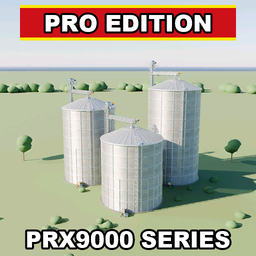 | **[Pro X (PRX) Silo Extensions](https://github.com/DTM-Mods/FS25_PRX9000)** | PropaineX |  |  |  |
|  | **[Monthly Expense Sheet Pro Edition](https://github.com/DTM-Mods/FS25_MonthlyExpenseSheet)** | PropaineX |  |  |  |
| 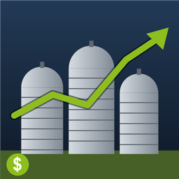 | **[Farm Inventory Pro Edition](https://github.com/DTM-Mods/FS25_FarmInventory)** | PropaineX |  |  |  |
|  | **[Ropa Tiger 6S Pro Edition](https://github.com/DTM-Mods/FS25_RopaTiger6S_ProEdition)** | PropaineX |  |  |  |
| 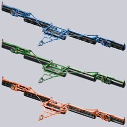 | **[Brandt LandRoller 591A Standalone](https://github.com/DTM-Mods/FS25_Brandt_Landroller_591_Pro)** | PropaineX |  |  |  |
| 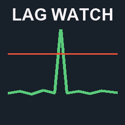 | **[Server Lag Watch](https://github.com/DTM-Mods/FS25_ServerLagWatch)** | PropaineX |  |  |  |
|  | **[ADAddOn (AutoDrive Add-On)](https://github.com/DTM-Mods/FS25_ADAddOn)**: needs [AutoDrive Overdrive](https://github.com/DTM-Mods/FS25_AutoDrive) | PropaineX |  |  |  |
|  | **[Input Alert](https://github.com/DTM-Mods/FS25_InputAlert)** | PropaineX |  |  |  |
| 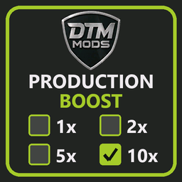 | **[Production Boost](https://github.com/DTM-Mods/FS25_ProductionBoost2510)** | PropaineX |  |  |  |
|  | **[Assisted Tree Felling](https://github.com/DTM-Mods/FS25_AssistedTreeFelling)** | PropaineX |  |  |  |
|  | **[Reactive Markets](https://github.com/DTM-Mods/FS25_ReactiveMarkets)** | PropaineX |  |  |  |

### Forks we work on

| | Mod | Original | Latest | Downloads | Stars |
| :-: | --- | --- | --- | :-: | :-: |
|  | **[AutoDrive Overdrive](https://github.com/DTM-Mods/FS25_AutoDrive)** | AutoDrive Team ([original](https://github.com/Stephan-S/FS25_AutoDrive)) |  |  |  |
|  | **[Courseplay](https://github.com/DTM-Mods/FS25_Courseplay)** | Courseplay devTeam ([original](https://github.com/Courseplay/Courseplay_FS25)) |  |  |  |
|  | **[Better Contracts](https://github.com/DTM-Mods/FS25_BetterContracts)** | Mmtrx ([original](https://github.com/Mmtrx/FS25_BetterContracts)) |  |  |  |

### For modders

Tools for making mods. Single player only, they never go on a server.

| | Tool | By | Latest | Downloads | Stars |
| :-: | --- | --- | --- | :-: | :-: |
|  | **[DTM Screenshot Studio](https://github.com/DTM-Mods/FS25_ScreenshotStudio)**: the game takes the ModHub screenshots of your mod | Fennell |  |  |  |
|  | **[DTM Video Studio](https://github.com/DTM-Mods/FS25_VideoStudio)**: the game films your mod, the tools cut and score the video | Fennell |  |  |  |

  

Download the zip from the mod's **Latest** release and put it, without unzipping or renaming it, in
`Documents/My Games/FarmingSimulator2025/mods`.

### Bugs and requests

Open an issue in the mod's repository, or ask us on [Discord](https://discord.gg/2GTU9hAa3Q). Please attach your `log.txt` and say which mod version you're on.

### Where else to find us

Videos of the mods are on [YouTube](https://www.youtube.com/@DTMMods). The same zips are also on
[itch.io](https://dtmmods.itch.io) and [KingMods](https://www.kingmods.net/en/profile/dtmmods).

### Support DTM Mods

Our mods are free. If they make your farm run better and you'd like to say thanks,
you can buy us a coffee on [Ko-fi](https://ko-fi.com/dtmmods) or donate with [PayPal](https://www.paypal.com/donate/?business=dtmmods%40gmail.com&no_recurring=0&item_name=DTM+Mods&currency_code=USD).
It helps pay for the server and keeps the mods coming.

   
  DTM Mods (Designed To Manage) by PropaineX & Fennell

